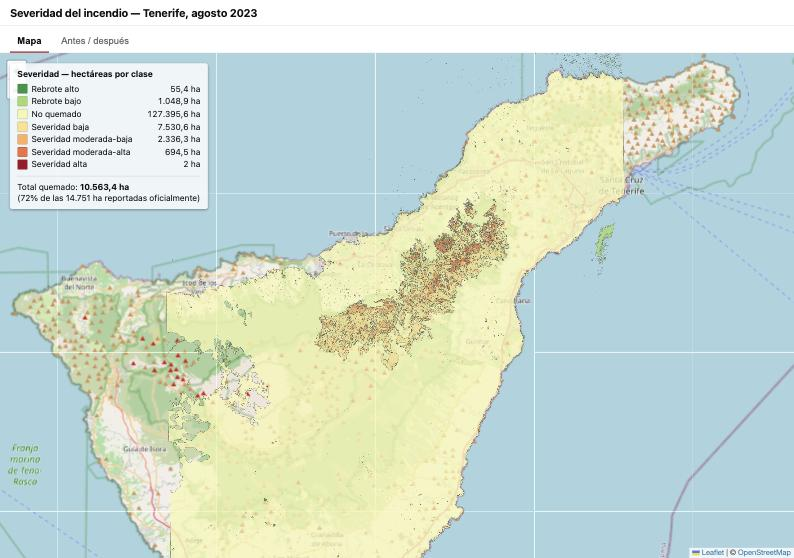
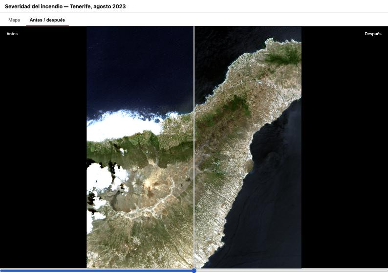
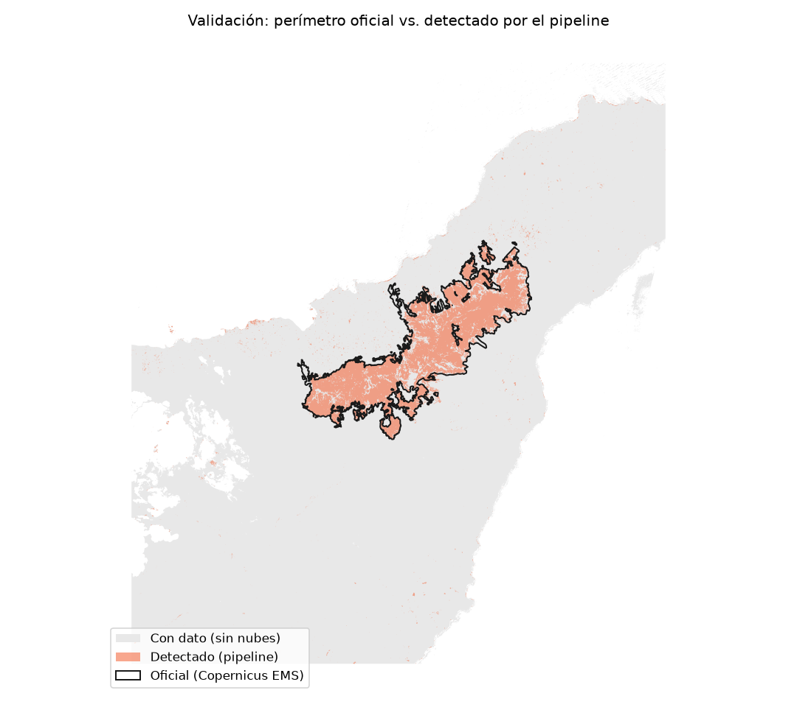

# canaries-burn-severity

Severidad del incendio de Tenerife (agosto 2023) a partir de imágenes Sentinel-2 de antes y
después del fuego: pipeline de procesamiento, API, base de datos espacial y visor web, de
punta a punta.

## Problema

En agosto de 2023 un incendio forestal (intencionado, según confirmó el Gobierno de
Canarias) arrasó varios miles de hectáreas en el norte de Tenerife, entre Arafo y
Candelaria. Después de un incendio así, hay preguntas concretas que alguien tiene que
responder con datos, no a ojo: ¿cuánta superficie se quemó realmente? ¿con qué intensidad,
zona por zona? ¿qué tan bien coincide lo detectado con el perímetro oficial? Este proyecto
construye, de punta a punta, el pipeline que responde esas preguntas a partir de imágenes
satelitales gratuitas — desde bajar las escenas de Sentinel-2 hasta un visor web donde se
puede explorar el resultado.

## Método

1. **Buscar escenas** Sentinel-2 L2A de antes y después del incendio, con pocas nubes, vía
   STAC (sin descargar nada todavía — solo metadata).
2. **Cargar bandas** B8A/B12, recortadas al área de estudio, y taparle las nubes/sombras/agua
   usando la banda SCL que ya viene con la imagen.
3. **Calcular NBR y dNBR**:
   - `NBR = (NIR − SWIR2) / (NIR + SWIR2)` → en Sentinel-2: `(B8A − B12) / (B8A + B12)`
   - `dNBR = NBR_antes − NBR_después` → cuanto más alto, más severa la quema
   - Clasificar cada píxel en 7 clases según los umbrales USGS (Key & Benson)
4. **Vectorizar**: convertir la grilla de píxeles clasificados en polígonos, y calcular
   hectáreas por clase.
5. **Validar** contra el perímetro oficial de la activación Copernicus EMS
   [EMSR685](https://mapping.emergency.copernicus.eu/activations/EMSR685/): IoU, cobertura,
   precisión.
6. **Servir y mostrar**: los polígonos van a PostGIS, una API en FastAPI los expone como
   GeoJSON, y un visor en React + Leaflet los pinta en un mapa — con un comparador de
   imágenes antes/después y un panel de hectáreas por clase.

Resultado de la validación (con el `BBOX` corregido, ver Limitaciones): **IoU 73,9%**,
cobertura del perímetro oficial 79,1%, precisión 91,9% — ver `pipeline/validate.py` y
[docs/validacion.png](docs/validacion.png).

## Diagrama

```mermaid
flowchart LR
    A["Sentinel-2 L2A\n(Planetary Computer, STAC)"] --> B["pipeline/\nNBR, dNBR, severidad, vectorizar"]
    B --> C[("PostGIS\n(Docker)")]
    C --> D["API\n(FastAPI)"]
    D --> E["Visor\n(React + Leaflet)"]
    B -. export_static.py .-> F["web/public/\nGeoJSON + JPG"]
    F --> G["Netlify\n(deploy estatico)"]
```

`pipeline/` corre local (necesita red, para bajar las escenas). `api/` y la base de datos
también corren local, con Docker — no están deployadas. El sitio público en Netlify no
depende de ninguna de las dos: usa la foto estática que generó `export_static.py` (ver
"Deploy a Netlify" más abajo).

## Capturas

**Visor — mapa de severidad**, con el panel de hectáreas por clase:



**Comparador antes/después**, color verdadero, con slider:



**Validación contra el perímetro oficial** (Copernicus EMS en contorno negro, detectado en
naranja, huella sin nubes en gris):



## Stack

- **Pipeline**: Python — `pystac-client`, `planetary-computer`, `stackstac`, `rioxarray`,
  `rasterio`, `geopandas`, `numpy`, `matplotlib`, `Pillow`
- **Datos**: Sentinel-2 L2A desde [Microsoft Planetary Computer](https://planetarycomputer.microsoft.com/)
  (STAC, sin cuenta para buscar)
- **Backend**: PostgreSQL + PostGIS (Docker), API con FastAPI
- **Frontend**: React + Vite + Leaflet (`react-leaflet`)
- **Deploy**: frontend en Netlify con datos estáticos; API local con `docker compose`

## Estructura del repo

```
pipeline/   # scripts de procesamiento
api/        # FastAPI
web/        # React + Leaflet
data/       # datos descargados e intermedios (fuera de git)
docs/       # diagrama, capturas
docker-compose.yml
netlify.toml
README.md
```

## Área de estudio

Incendio de Tenerife, agosto 2023 (Arafo, Candelaria, valle de Güímar y norte), activación
Copernicus EMS [EMSR685](https://mapping.emergency.copernicus.eu/activations/EMSR685/). El
área, las ventanas de fechas y la superficie oficial de referencia están en
[`pipeline/config.py`](pipeline/config.py), no hardcodeadas en el código de procesamiento.

## Limitaciones conocidas

- **Una sola escena Sentinel-2 por fecha** (un solo tile, T28RCS): si el `BBOX` se extendiera
  a un tile vecino, esa franja quedaría sin dato (se ve como manchas negras en los bordes
  de las imágenes de `export_truecolor.py`). No hay mosaico de varios tiles.
- **El margen del `BBOX` se eligió a mano**: los 4 bordes en `pipeline/config.py` son números
  redondos en grados. Más prolijo: bounds del perímetro oficial + buffer fijo en metros (ej.
  2 km) en la proyección métrica, para que el margen sea una decisión explícita y
  reproducible, no un número tipeado una vez. (El propio `BBOX` original tenía este problema
  en serio: el borde norte dejaba ~23% del incendio real fuera de la zona descargada hasta
  que se corrigió — ver el historial de commits.)
- **Dos superficies "oficiales" distintas, sin aclarar en la UI**: el panel de estadísticas
  del visor compara el área detectada contra `REPORTED_AREA_HA` (14.751 ha, cifra de prensa
  de Protección Civil), mientras que `pipeline/validate.py` compara contra el polígono exacto
  de Copernicus EMS (12.273,95 ha) — son fuentes distintas que no coinciden entre sí. Por eso
  el visor muestra 72% y la validación 79% de cobertura: no es un error, son denominadores
  distintos, pero debería aclararse en la propia UI.
- **La clasificación SCL (nube/sombra/agua) de Sentinel-2 no siempre es confiable**: durante
  este proyecto se encontró dos veces que SCL clasificó la misma zona de forma muy distinta
  entre dos escenas (una vez con el agua: 0,6% vs. 45,8% del cuadro clasificado "agua" en
  escenas de fechas distintas). El pipeline de severidad (`load_bands.py`) sigue confiando en
  SCL para tapar nubes/sombra/agua antes de calcular NBR — ahí sí hace falta, porque esos
  píxeles rompen la cuenta — pero es una dependencia con fallas conocidas, no infalible.
- **"Diario" no es realista con Sentinel-2 solo**: la revisita combinada de los dos satélites
  es cada ~5 días en el ecuador, y menos seguido si ese día justo está nublado. Una
  aplicación de monitoreo continuo necesitaría otra fuente (radar Sentinel-1, que atraviesa
  nubes) para llenar los huecos.
- **El GeoJSON estático se simplifica solo para el deploy** (`pipeline/export_static.py`,
  tolerancia ~22m): la API local sigue sirviendo la geometría completa. Son dos precisiones
  distintas a propósito, pero conviene saberlo si se comparan números entre el deploy y la
  API local.
- **Las imágenes de deploy pesan bastante** (~4 MB los dos JPG juntos, ~7 MB el GeoJSON)
  para un sitio estático — funciona, pero con más tiempo se podría bajar más la resolución
  o usar tiles en vez de una imagen única.

## Deploy a Netlify

El frontend desplegado usa datos **estáticos**, no la API (que solo corre local, con
`docker compose`):

```bash
# con la API local corriendo (docker compose up -d + uvicorn):
cd pipeline
python3 export_static.py   # snapshot de /severity, /severity/stats y las
                            # imágenes a web/public/ (GeoJSON simplificado,
                            # imágenes recomprimidas a JPEG)

cd ../web
npm run build               # usa web/public/*.json|geojson|jpg, no la API
npm run preview             # probarlo local antes de pushear
```

`netlify.toml` (en la raíz) le dice a Netlify que la app vive en `web/`: conectar el repo,
base directory `web`, build command `npm run build`, publish dir `dist`. Los archivos
generados por `export_static.py` se commitean (no están en `.gitignore`, a diferencia de
`data/`): Netlify no tiene la base de datos ni la API para regenerarlos en su propio build.

## Cómo correrlo

```bash
python3 -m venv .venv
source .venv/bin/activate
pip install -r requirements.txt
```

Los scripts se corren desde `pipeline/`, en orden:

```bash
cd pipeline
python3 search_scenes.py       # busca las escenas con menos nubes (issue #3)
python3 load_bands.py          # carga B8A/B12 y aplica la máscara de nubes (issue #4)
python3 preview_bands.py       # guarda data/bands_preview.png, para verificar a simple vista
python3 calculate_severity.py  # calcula NBR, dNBR y clasifica severidad (issue #5)
python3 vectorize_severity.py  # vectoriza a polígonos y calcula hectáreas por clase (issue #6)
python3 validate.py            # compara contra el perímetro oficial de Copernicus EMS (issue #7)
python3 export_truecolor.py    # guarda data/rgb_before.png y rgb_after.png, color verdadero (issue #11)
```

(`export_static.py`, para el deploy, va después — necesita la API corriendo, ver "Deploy a
Netlify" arriba.)

Base de datos (PostGIS, en Docker):

```bash
docker compose up -d
cd pipeline
python3 load_to_postgis.py  # carga severity.geojson a la tabla severity_polygons (issue #8)
```

API (FastAPI, issue #9) — necesita la base de datos corriendo:

```bash
cd api
uvicorn main:app --reload --port 8000
```

- `GET /health` — healthcheck
- `GET /severity` — los 21.602 polígonos como GeoJSON (`?severity=` filtra por clase, p. ej. `Severidad alta`)
- `GET /severity/stats` — hectáreas y cantidad de polígonos por clase
- `GET /imagery/rgb_before.png` / `rgb_after.png` — color verdadero antes/después (issue #11)

Visor (React + Vite + Leaflet, issues #10-#11) — necesita la API corriendo:

```bash
cd web
npm install
npm run dev
```

Abre `http://localhost:5173`. Pestaña **Mapa**: los 21.602 polígonos de
`GET /severity` sobre OpenStreetMap, coloreados por clase, con un panel de
hectáreas por clase (`GET /severity/stats`) y un popup por polígono al hacer
clic. Pestaña **Antes / después**: comparador con slider entre las imágenes
de color verdadero antes/después del incendio.

Tests (no requieren red ni datos reales):

```bash
cd pipeline
python3 -m pytest

cd api
python3 -m pytest
```

## Estado del proyecto

- [x] #1 Estructura del repo y entorno
- [x] #2 Área de estudio y fechas
- [x] #3 Búsqueda de escenas Sentinel-2
- [x] #4 Carga de bandas y máscara de nubes
- [x] #5 NBR, dNBR y clases de severidad
- [x] #6 Vectorización y estadísticas
- [x] #7 Validación
- [x] #8 PostGIS en Docker
- [x] #9 API con FastAPI
- [x] #10 Visor React + Leaflet
- [x] #11 Comparador antes/después y panel
- [x] #12 Deploy
- [x] #13 README final
- [x] #15 Clasificador con machine learning (extra) — evaluado, no implementado (ver nota abajo)

### Sobre el #15 (Random Forest)

Se evaluó entrenar un Random Forest quemado/no-quemado (features: B8A/B12 antes y después,
NBR, dNBR; etiqueta: perímetro oficial de Copernicus EMS). La idea en sí es válida — hay
millones de píxeles como ejemplos, no "un solo dato" — pero se decidió no implementarla:
todos esos píxeles salen del mismo incendio, mismo lugar, mismas dos fechas. Un modelo
entrenado así podría funcionar bien evaluado dentro de este mismo evento, pero no hay forma
de afirmar que generalice a otro incendio, en otra vegetación o época del año. Sin más de un
evento para entrenar/validar, el valor agregado sobre el método de umbral fijo (NBR/dNBR,
USGS) no se puede demostrar de forma honesta.
